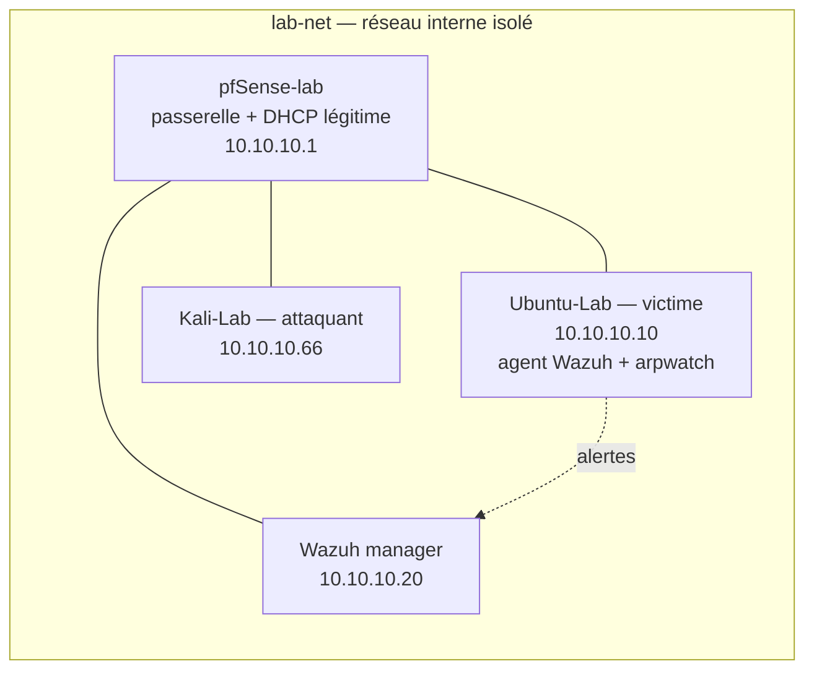

# soc-lab — Détection d'attaques réseau de couche 2

Lab personnel (VirtualBox) de **détection d'attaques de couche 2** sur un réseau isolé :
ARP spoofing / MITM et rogue DHCP, mis en évidence avec **Wireshark** et un SIEM **Wazuh**.
L'objectif est défensif : générer un trafic d'attaque maîtrisé pour construire et valider
les détections côté bleu.

> **Statut : squelette documenté, preuves à capturer.**
> Les scénarios offensifs sont décrits comme procédures reproductibles ; les règles Wazuh
> et décodeurs sont des modèles à valider sur logs réels. Chaque capture/alerte manquante
> est listée dans [`captures/`](captures/) sous forme de `TODO-PREUVE_*.md`.
> **Aucune capture ni sortie de log n'est inventée dans ce dépôt.**

## Topologie

Réseau interne VirtualBox `lab-net`, totalement isolé (voir [`topology/`](topology/)).



## Scénarios et détection

| Scénario | Technique MITRE | Source de détection | Règle / alerte Wazuh |
|---|---|---|---|
| ARP spoofing / MITM | T1557.002 | arpwatch + Wireshark | `100100` (niveau 10) |
| Rogue DHCP | T1557 | logs DHCP + Wireshark | `100110` (niveau 12) |

Détail des scénarios : [`attacks/README.md`](attacks/README.md).
Filtres et notes d'analyse : [`detection/wireshark/filtres.md`](detection/wireshark/filtres.md).
Règles et décodeurs : [`detection/wazuh/`](detection/wazuh/).
Indicateurs + MITRE : [`docs/IoC.md`](docs/IoC.md).

## Structure du dépôt

```
topology/            schéma de topologie, plan d'adressage, isolement
attacks/             procédures offensives reproductibles (orientées détection)
detection/
  wireshark/         filtres d'affichage et notes d'analyse
  wazuh/             local_rules.xml, decoders.xml, ossec.conf.sample
captures/            pcap + captures d'écran (ou TODO-PREUVE_*.md en attente)
docs/IoC.md          indicateurs de compromission + correspondance MITRE ATT&CK
```

## Reproduire le lab

1. **Prérequis** : VirtualBox, VM `pfSense-lab`, `Ubuntu-Lab`, `Kali-Lab` sur le réseau
   interne `lab-net` ; un manager Wazuh à déployer (10.10.10.20).
2. **Sécurité** : déconnecter la carte pontée des VM pendant les attaques
   (voir [`topology/README.md`](topology/README.md)). Ne jamais rejouer ces scénarios
   hors d'un réseau que l'on possède.
3. **Détection** : installer l'agent Wazuh et `arpwatch` sur la victime, déposer les
   règles/décodeurs de [`detection/wazuh/`](detection/wazuh/), créer la liste des
   serveurs DHCP autorisés, redémarrer le manager.
4. **Validation** : rejouer chaque scénario, capturer pcap + alertes, remplacer les
   `TODO-PREUVE_*.md` par les preuves réelles, et vérifier les règles avec `wazuh-logtest`.

## Avertissement

Ce dépôt est fourni à des fins **pédagogiques et défensives**. Les techniques décrites ne
doivent être employées que sur une infrastructure dont on est propriétaire, dans un
environnement isolé.

## Licence

[MIT](LICENSE) — © 2026 HARCHOUNE Abdellah
