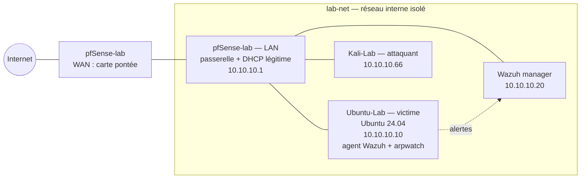

# Topologie du lab

Réseau interne VirtualBox **`lab-net`** (type « Réseau interne ») : aucun accès direct
depuis l'hôte ni depuis Internet. pfSense fait office de passerelle et de serveur DHCP
légitime.



## Plan d'adressage

| Machine | VM VirtualBox | Rôle | IP (lab-net) | Statut |
|---|---|---|---|---|
| Passerelle | `pfSense-lab` | routeur, DHCP légitime | 10.10.10.1/24 | à confirmer |
| Victime | `Ubuntu-Lab` | poste cible, agent Wazuh, capteur | 10.10.10.10/24 | à confirmer |
| Attaquant | `Kali-Lab` | ARP spoofing, rogue DHCP | 10.10.10.66/24 | à confirmer |
| SIEM | à créer (VM ou conteneur) | Wazuh manager + dashboard | 10.10.10.20/24 | à installer |

Les adresses sont provisoires : les remplacer par les adresses réelles une fois relevées
(`ip -br a` sur chaque VM) — voir `captures/TODO-PREUVE_topologie.md`.

## Règle d'isolement

`Ubuntu-Lab` et `Kali-Lab` ont aussi une **2ᵉ carte en mode pont** (Wi-Fi de l'hôte).
Pendant les attaques, cette carte doit être **déconnectée** pour que l'empoisonnement ARP
et le faux DHCP ne touchent jamais le réseau domestique :

```bash
VBoxManage controlvm "Kali-Lab"   setlinkstate2 off
VBoxManage controlvm "Ubuntu-Lab" setlinkstate2 off
```
